  <picture>
    <source media="(max-width: 640px)" srcset="assets/hero-narrow.svg">
    
  </picture>

  
  
  
  

  <picture>
    <source media="(max-width: 640px)" srcset="assets/section-about-narrow.svg">
    
  </picture>

I am a software engineer from Dhaka. I spent four years in Penang studying Software Engineering at Universiti Sains Malaysia, and for most of that time I also worked part-time at a hotel in George Town, running the front-desk records and looking after its website. I finished in August 2026 and moved back home the month after.

My first engineering job was an internship at ECTrons in 2025, where I designed Virtual Zara. It was an n8n agent that connected GitLab, Google Workspace, Microsoft Graph, Telegram and OpenAI, so staff in HR, finance and project management could send it text, voice or a document and get a report or a PDF back. My final-year project, BahasaBot, teaches Malay to international students and won a Silver Award at the PIXEL 2026 showcase.

In November 2026 I was given five days for a take-home assessment and had no laptop with me, so I built DocIntel from my phone. It is the first card under Featured.

I am looking for AI engineering and automation work, and I am open to relocating or working remotely. Right now I am going back over Python and core computer science fundamentals and learning German. Away from the keyboard I take photographs and short videos (130 of them are on Pexels) and read about psychology, geopolitics and religion.

  <picture>
    <source media="(max-width: 640px)" srcset="assets/section-build-narrow.svg">
    
  </picture>

  <picture>
    <source media="(max-width: 640px)" srcset="assets/method-narrow.svg">
    
  </picture>

I write things down before I build them. The requirements come first, then a short file of rules the build is never allowed to break, then a plan cut into phases. The code comes after that, one phase at a time, with AI coding tools (mainly Claude Code), and I log each decision as I make it. DocIntel has 89 decisions on record. Vindeshi Express started from 81 written requirements, and each commit names the requirement it satisfies.

  <picture>
    <source media="(max-width: 640px)" srcset="assets/section-featured-narrow.svg">
    
  </picture>

  <a href="https://github.com/Sowan3k/AI-Powered-Document-Intelligence-System">
    <picture>
      <source media="(max-width: 640px)" srcset="assets/docintel-narrow.svg">
      
    </picture>
  </a>

**DocIntel** reads invoices, whether they arrive as clean PDFs, scans, phone photos, TIFF files, Excel sheets or CSV. Gemini pulls out each field and has to show the text it read it from. It does none of the arithmetic. Eleven rules in exact decimal maths check the sums, the tax and the dates, and anything that fails goes to a person to review. On a labelled set of 91 synthetic invoices, all eight fields came out right on every one. Real invoices are messier than synthetic ones, and the evaluation report says where it struggled: on phone photos it got 87.5% of fields.

[Repository](https://github.com/Sowan3k/AI-Powered-Document-Intelligence-System) · [Walkthrough video](https://youtu.be/n9xKvACPR90) · [Evaluation report](https://github.com/Sowan3k/AI-Powered-Document-Intelligence-System/blob/main/docs/EVALUATION.md) · [API docs](https://docintel-api-y25b.onrender.com/api/docs) · [Web app](https://docintel-tan-two.vercel.app) (sign-in required)

  <a href="https://bahasa-bot.vercel.app">
    <picture>
      <source media="(max-width: 640px)" srcset="assets/bahasabot-narrow.svg">
      
    </picture>
  </a>

**BahasaBot** is a Malay tutor for international students, who must pass the Bahasa Malaysia subject at Malaysian public universities. The chatbot answers from a small corpus of Malaysian Malay held in pgvector and streams its replies. The course generator builds modules and quizzes for any topic, and the first time that took about 78 seconds. A template-and-clone layer brought a repeat of the same topic down to about 280 ms and zero tokens. The quiz tracks what each learner gets wrong and places them again on a four-level scale (BPS-1 to BPS-4), using their last three attempts. Thirty people used it and rated it 4.3 out of 5 in the app.

[Live demo](https://bahasa-bot.vercel.app) (the server sleeps, so the first load can take a minute) · [Repository](https://github.com/Sowan3k/BahasaBot)

  <picture>
    <source media="(max-width: 640px)" srcset="assets/section-more-narrow.svg">
    
  </picture>

**[Vindeshi Express](https://github.com/Sowan3k/Project-V)** · in testing 
A map of study-abroad routes for Bangladeshi students, meant to be kept current by the community. Nothing in the shared data can be deleted, only revised. PostgreSQL triggers, a Prisma extension and a lint rule each enforce that.

**[ChargeWatch](https://github.com/Sowan3k/chargewatch)** · open source 
For when one phone is charging in another room. It tells the phone in your hand when the other one reaches 80% and when it is full. The app is under 500 KB and has no account and no server of mine. A release only ships after an emulator plays the second phone and both alerts arrive.

**[USM Evently](https://usm-evently.vercel.app)** · live demo · [repository](https://github.com/Sowan3k/usm_evently) 
Campus events for USM students: browse, RSVP, check in by QR code and collect MyCSD co-curricular points. It has three roles and runs in English and Bahasa Malaysia. The payments are simulated.

**[My Bibi](https://github.com/Sowan3k/My-Bibi-App)** · open source 
A private chat and journal app you host yourself with one `docker compose up`. The AI runs on local Ollama models. Each journal is encrypted at rest with a key derived from its owner's password, so whoever hosts the server cannot read it.

**[Grab Real-Time Demo](https://grab-realtime-demo.onrender.com)** · team coursework · [repository](https://github.com/Sowan3k/grab-realtime-demo) 
A ride-hailing operations dashboard that four of us built for a real-time systems course. Fatigue alerts have 2 seconds to fire and surge prices have 500 ms to reach every client.

**Virtual Zara** · internal, ECTrons 
The n8n agent from my internship. It covered five connected systems and three business areas, and took input by text, voice or document. The code belongs to ECTrons, so there is nothing to link.

  <picture>
    <source media="(max-width: 640px)" srcset="assets/section-stack-narrow.svg">
    
  </picture>

  <picture>
    <source media="(max-width: 640px)" srcset="assets/stack-narrow.svg">
    
  </picture>

Rows are tools and columns are things I built. A lit square means that tool is in that build, so the grid only lists what I have shipped with. I also use Figma, Postman, the Linux command line and a Raspberry Pi 5 when the work calls for them.

  <picture>
    <source media="(max-width: 640px)" srcset="assets/section-github-narrow.svg">
    
  </picture>

This is the real contribution graph. The one at the top of the page is a drawing.

  <picture>
    <source media="(prefers-color-scheme: dark)" srcset="https://raw.githubusercontent.com/Sowan3k/Sowan3k/output/snake-dark.svg">
    
  </picture>

  
  

  

  <picture>
    <source media="(max-width: 640px)" srcset="assets/footer-narrow.svg">
    
  </picture>

  
  
  
  

  

