  

  
  
  
  

## About

I am a software engineer in Dhaka, Bangladesh. I studied Software Engineering at Universiti Sains Malaysia in Penang and finished in August 2026.

Most of my work is AI automation and the full-stack systems around it. At ECTrons in 2025 I designed Virtual Zara, an n8n agent that connected GitLab, Google Workspace, Microsoft Graph, Telegram and OpenAI for the company's HR, finance and project teams. My final-year project, BahasaBot, won a Silver Award at the PIXEL 2026 showcase. In November 2026 I built DocIntel, an invoice-processing system, in five days from my phone.

I am looking for AI engineering and automation roles, and I am open to relocation and remote work. Outside of code I read on psychology, geopolitics and religion, and I publish photographs on Pexels.

## How I build

  

I write the requirements, a short file of rules the build must never break, and a phased plan before any code. Then I build phase by phase with AI coding tools, mainly Claude Code, and log each decision. DocIntel has 89 recorded decisions. Vindeshi Express started from a baseline of 81 functional requirements, and its commits cite the requirement each one satisfies.

## Featured

  

**DocIntel** reads invoices from digital and scanned PDFs, phone photos, TIFF, Excel and CSV. Gemini extracts each field with a confidence score and the source text it came from. Eleven validation rules in exact decimal arithmetic check the numbers and send failures to a review queue. With real Gemini models on a labelled synthetic dataset, all eight fields were correct on 91 of 91 invoices. I built it in five days as a technical assessment, through Claude Code sessions driven by written specifications.

[Repository](https://github.com/Sowan3k/AI-Powered-Document-Intelligence-System) · [Walkthrough video](https://youtu.be/n9xKvACPR90) · [API docs](https://docintel-api-y25b.onrender.com/api/docs) · [Evaluation report](https://github.com/Sowan3k/AI-Powered-Document-Intelligence-System/blob/main/docs/EVALUATION.md) · [Web app](https://docintel-tan-two.vercel.app) (sign-in required)

  

**BahasaBot** teaches Malay to international students at Malaysian public universities. A RAG chatbot streams replies over Server-Sent Events from a pgvector store. A course generator turns any topic into modules and quizzes, and a template-and-clone layer cut a repeat course from about 78 seconds and 21,300 tokens to about 280 ms and zero tokens. The adaptive quiz recalculates the learner's level on the BahasaBot Proficiency Scale (BPS-1 to BPS-4) from the last three attempts.

[Live demo](https://bahasa-bot.vercel.app) (the first load can take a minute) · [Repository](https://github.com/Sowan3k/BahasaBot)

## More builds

| Project | What it is | Stack |
| --- | --- | --- |
| **[Vindeshi&nbsp;Express](https://github.com/Sowan3k/Project-V)** in&nbsp;testing | Community-maintained map of study-abroad routes for Bangladeshi students. Shared knowledge is append-only, enforced by PostgreSQL triggers, a Prisma client extension and an ESLint import boundary. Unit and Playwright suites run in CI. | Next.js 15, React 19, TypeScript, Prisma, Neon Postgres, Auth.js, Vitest, Playwright, GitHub Actions |
| **[ChargeWatch](https://github.com/Sowan3k/chargewatch)** open&nbsp;source | Android app under 500 KB that tells a second phone when the first reaches 80% and when it is full. No account and no backend. Phones pair by QR code and talk through the ntfy push relay. Every release passes an end-to-end test on an Android 14 emulator. | Kotlin, Android, ntfy, GitHub Actions |
| **[USM&nbsp;Evently](https://usm-evently.vercel.app)** live&nbsp;demo | Campus events platform for USM. Three roles, QR check-in, MyCSD co-curricular points, English and Bahasa Malaysia. Payments are simulated. [Repository](https://github.com/Sowan3k/usm_evently) | Next.js 15, TypeScript, Prisma, Neon Postgres, NextAuth, Zod, Tailwind, shadcn/ui |
| **[My&nbsp;Bibi](https://github.com/Sowan3k/My-Bibi-App)** open&nbsp;source | Self-hosted private chat and journal app. Local Ollama models, PWA, journals encrypted at rest with a key derived from each user's password. | Next.js, FastAPI, SQLite FTS5, Ollama, Docker Compose |
| **[Grab&nbsp;Real&#8209;Time&nbsp;Demo](https://grab-realtime-demo.onrender.com)** team&nbsp;coursework | Ride-hailing operations dashboard for CSE443, built by a team of four. Driver fatigue alerts within a 2 s deadline, surge pricing pushed over WebSocket within 500 ms. [Repository](https://github.com/Sowan3k/grab-realtime-demo) | Node.js, Express, WebSocket |
| **Virtual&nbsp;Zara** internal,&nbsp;ECTrons | n8n automation agent across five systems and three business areas. Takes text, voice and documents, generates documents and PDFs, and turns GitLab activity into project reports. No public code. | n8n, JavaScript, OpenAI API, GitLab API, Google Workspace APIs, Microsoft Graph API, Telegram Bot API |

## Stack

**Languages**

    

**AI and automation**

       

**Backend and data**

         

**Frontend and mobile**

    

**Testing and delivery**

        

**Also**

  

## GitHub

  
  

  

  <picture>
    <source media="(prefers-color-scheme: dark)" srcset="https://raw.githubusercontent.com/Sowan3k/Sowan3k/output/snake-dark.svg">
    
  </picture>

  

